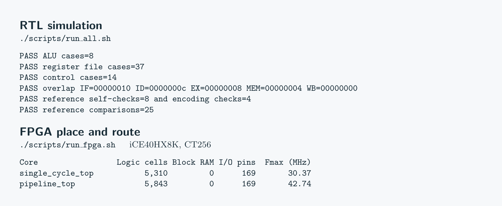
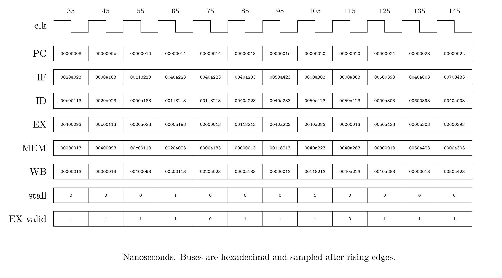

# 5-Stage Pipelined RISC-V Processor

Verilog-2001 project for Modern Computer Architecture at Newton School of Technology, Rishihood University. The five-stage core uses forwarding, a one-cycle load-use stall, and a two-slot flush on taken branches. A single-cycle core runs the same RV32I subset: ADD, SUB, ADDI, LW, SW, BEQ, and BNE.

[Architecture and evaluation (IEEE report)](docs/report/riscv-pipeline-architecture-and-evaluation.pdf) · [IEEE source](docs/report/riscv-pipeline-architecture-and-evaluation.tex) · [FPGA synthesis report](docs/report/riscv-pipeline-fpga-synthesis-and-timing.pdf) · [Phase I report](docs/report/report.pdf) · [Demo video](https://drive.google.com/file/d/1nLgo7ZT6DUxGFKc5UvzmLJH2ZwtNONWA/view) · [GitHub Actions](https://github.com/aryankinha/riscv-pipex/actions/workflows/test.yml)

## Run the tests on macOS

Install [Homebrew](https://docs.brew.sh/Installation) if needed. If using a ZIP, open Terminal in the extracted folder and skip the clone and `cd` commands.

```sh
brew install git python icarus-verilog
git clone https://github.com/aryankinha/riscv-pipex.git
cd riscv-pipex
./scripts/run_all.sh
cat build/benchmarks.csv
```

The suite checks 59 RTL unit cases and compares 25 program runs against the instruction model. It ends with `PASS reference comparisons=25`. Each run recreates `build/`.

## Results

Both cores retire the same instructions. The pipeline's extra cycles come from fill, load-use stalls, and taken branches.

| Benchmark | Retired | Single-cycle cycles | Pipeline cycles | Pipeline CPI | Pipeline IPC |
| --- | ---: | ---: | ---: | ---: | ---: |
| ALU chain | 7 | 7 | 11 | 1.571 | 0.636 |
| Load use | 14 | 14 | 21 | 1.500 | 0.667 |
| Branch loop | 18 | 18 | 31 | 1.722 | 0.581 |

The single-cycle core has CPI and IPC of 1.000 on all three benchmarks. On the routed iCE40HX8K design, the pipeline uses 5,843 logic cells at an estimated 42.74 MHz. The baseline uses 5,310 at 30.37 MHz. The baseline still finishes the short branch loop sooner at these estimated clocks.



## Inspect the waveforms

Run the tests first. Open each view separately.

```sh
brew install surfer
surfer -c docs/waveforms/load_use.sucl build/load_use.vcd
surfer -c docs/waveforms/branches.sucl build/03_branches.vcd
```

In the load-use trace, follow 65–85 ns. The stall holds PC and ID while EX receives a bubble. The dependent ADDI then enters EX as its load reaches WB. In the branch view, follow `taken` to the PC redirect and the cleared ID and EX entries.



## Reproduce the FPGA run

```sh
brew install yosys nextpnr-ice40
./scripts/run_fpga.sh
cat build/fpga/summary.csv
```

This routes both cores on iCE40HX8K (CT256) with the same branch-loop ROM. The estimates use automatic pin placement. Physical-board testing remains pending. The [synthesis report](docs/report/riscv-pipeline-fpga-synthesis-and-timing.pdf) records mapped resources, critical paths, and verification.

## Files

- `rtl/` holds both cores. `tb/` holds the testbenches.
- `programs/benchmarks/` holds the assembly, hex, and expected state for each benchmark.
- `docs/` holds the IEEE reports, diagrams, and waveforms. To rebuild the waveform and both Phase II reports, use TeX with IEEEtran and TikZ, plus Poppler. Run the tests first.

```sh
brew install --cask mactex-no-gui
brew install poppler
python3 scripts/render_waveform.py load_use
cd docs/report
pdflatex -interaction=nonstopmode -halt-on-error riscv-pipeline-architecture-and-evaluation.tex
pdflatex -interaction=nonstopmode -halt-on-error riscv-pipeline-architecture-and-evaluation.tex
pdflatex -interaction=nonstopmode -halt-on-error riscv-pipeline-fpga-synthesis-and-timing.tex
```

## Team

| Member | Student ID | Email | Module ownership |
| --- | --- | --- | --- |
| Aryan Kinha (lead) | 2401020013 | aryan.kinha2024@nst.rishihood.edu.in | Integration and testing |
| Preetish Ubhrani | 2401020050 | preetish.ubhrani2024@nst.rishihood.edu.in | Execute and branch logic |
| Divyanshu Singh | 2401010161 | divyanshu.singh2024@nst.rishihood.edu.in | Decode and control |
| Jatin Verma | 2401010200 | jatin.verma2024@nst.rishihood.edu.in | Memory and write-back |
| Jatin Kumar Singh | 2401010199 | jatin.singh2024@nst.rishihood.edu.in | Fetch and instruction memory |
